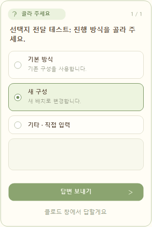
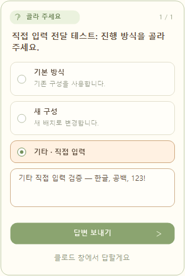
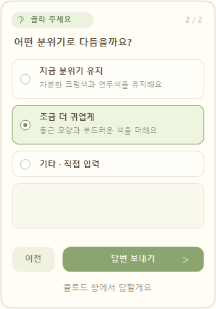
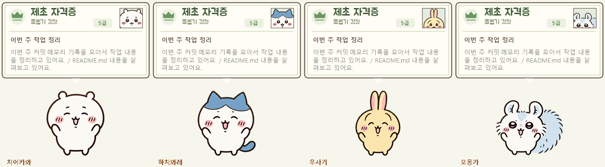

# 치이카와 Claude 펫

Claude가 일하는 동안 치이카와가 진행 내용을 말풍선으로 알려주는 Windows용 데스크톱 펫입니다. 비공식 팬 프로젝트입니다.

## 무엇을 하나요?

- 제초 자격증을 모티브로 한 카드 말풍선에 초록 왕관·5급 표기·치이카와 증명사진을 넣었습니다.
- 채팅 제목은 굵게, 진행 내용은 회색으로 표시합니다.
- Claude가 보내는 설명과 파일 읽기·수정 등 현재 작업을 보여줍니다.
- 승인이나 입력이 필요하면 알려주고, 응답이 끝나면 소리와 Windows 알림을 보냅니다.
- Claude의 질문(AskUserQuestion)이 나오면 카드 아래에 선택지를 표시합니다. 단일·복수 선택과 **기타 직접 입력**을 지원하며, **답변 보내기**를 눌러야 Claude에 전달됩니다.
- 드래그해서 놓은 자리에 고정되고, 다음 실행 때도 위치를 기억합니다.
- **치이카와·하치와레·우사기·모몽가** 중에서 캐릭터를 선택할 수 있고, 다음 실행 때도 선택을 기억합니다.
- Claude를 켜면 펫이 켜지고, 모든 Claude 프로세스를 종료하면 펫도 닫힙니다. 감지에는 약 3초가 걸립니다.

## 필요한 것

- Windows 10 또는 11
- Claude Code 또는 Claude 데스크톱 앱의 **로컬 Code 탭**
- Claude에 로그인하고 사용할 수 있는 상태

일반 Chat 탭, Cowork, 원격·클라우드·WSL 세션과 macOS·Linux는 이 버전의 지원 범위에 포함하지 않습니다. 펫만 설치해도 Claude의 이용 권한이 생기는 것은 아닙니다.

## 설치 — 한 번만 하면 돼요

1. 이 저장소에서 **Code → Download ZIP**을 선택하거나 저장소를 내려받습니다.
2. ZIP을 **모두 압축 해제**하고 계속 둘 폴더에 보관합니다. ZIP 안에서 바로 실행하지 마세요.
3. **Install.cmd**를 두 번 클릭합니다.
4. 설치 완료 안내를 확인한 후 Claude를 켭니다. 이미 열려 있던 Claude Code 세션은 다시 시작합니다.
5. Claude Code나 데스크톱의 로컬 Code 탭에서 작업을 시작하면 말풍선이 갱신됩니다.

API 키 입력이나 설정 파일 직접 편집은 필요하지 않습니다. 처음 설치하면 기존 Claude 설정을 백업한 뒤 상태 연결을 추가하고, Windows 로그인 후 자동으로 대기하는 작업을 등록합니다. 회사 PC 정책에 따라 스크립트 또는 작업 등록이 제한될 수 있습니다.

**설치 후에는 폴더를 이동하지 마세요.** 연결 설정이 설치한 폴더를 가리킵니다. 옮기려면 기존 폴더에서 Uninstall.cmd를 실행하고, 새 위치에서 Install.cmd를 실행하세요.

## 사용 방법

- 드래그: 위치 이동
- 우클릭 → **위치 초기화**: 현재 캐릭터를 주 모니터 왼쪽 아래로 이동하고 그 위치를 저장합니다. 캐릭터와 클릭 통과 설정은 유지합니다.
- 캐릭터 클릭: 반응 보기
- 캐릭터 두 번 클릭: 잠자기·깨우기
- 우클릭: 크기, 클릭 통과, 종료 등 설정
- **우클릭 → 캐릭터 선택**: 치이카와·하치와레·우사기·모몽가 중 하나로 변경. 펫 위치와 진행 중인 질문은 유지합니다.
- 클로드를 다시 켜기: 종료한 펫 자동 실행
- 질문이 뜨면: 선택지 또는 기타 입력 후 **답변 보내기**. 질문이 여러 개면 **다음**으로 이동합니다.
- 펫에서 답하지 않으려면: **클로드 창에서 답하기**를 누르면 원래 질문 화면으로 넘깁니다.

말풍선에서 특정 Claude 채팅으로 바로 이동하는 기능은 아직 구현되지 않았습니다.

## 설정을 따로 해야 하나요?

처음 한 번 Install.cmd를 실행하면 됩니다. 각 사용자의 Windows 계정과 설치 폴더에 맞춰 설정합니다. 제작자의 계정 정보나 PC 경로를 입력할 필요가 없습니다.

설치 프로그램은 다음을 바꿉니다.

- 사용자 `.claude/settings.json`: 상태 이벤트를 받는 hook 추가. 기존 설정과 다른 hook은 유지합니다.
- 같은 폴더의 `settings.json.chiikawa-backup-날짜`: 설정 변경 전 백업.
- Windows 작업 스케줄러 `ChiikawaClaudePet-Autostart`: 로그인 후 Claude 실행·종료를 로컬에서 확인.
- 펫 폴더: 상태 기록, 위치, 크기 설정 저장.

펫 자체는 추가 AI 요청이나 외부 서버 전송을 하지 않습니다. 말풍선 표시를 위해 공개된 Claude 설명 일부와 파일명·작업 종류·채팅 제목을 로컬 `status` 폴더에 기록합니다. 이 기록은 다른 사람에게 공유하지 마세요. 저장소에서는 제외됩니다.

질문을 처리할 때는 `questions` 폴더에 질문·답변을 잠시 보관하고, 전달이 끝나면 제거합니다. 답변은 해당 질문을 보낸 Claude 세션으로 전달합니다. 실행 권한 승인이나 일반 채팅의 입력창은 이 질문 패널의 대상이 아닙니다.

## 실제 Claude 답변 전달 테스트

2026-10-21에 테스트용 Claude 대화 4건으로 전달을 확인했습니다.

| 실행 환경 | 입력 방식 | 보낸 값과 Claude가 받은 값 | 결과 |
| --- | --- | --- | --- |
| Claude Code 2.1.245 | 선택지 | `새 구성` | 통과 |
| Claude Code 2.1.245 | 기타 직접 입력 | `기타 직접 입력 검증 — 한글, 공백, 123!` | 통과 |
| 데스크톱 Code 내장 엔진 2.1.304 | 선택지 | `새 구성` | 통과 |
| 데스크톱 Code 내장 엔진 2.1.304 | 기타 직접 입력 | `기타 직접 입력 검증 — 한글, 공백, 123!` | 통과 |

각 엔진을 질문 입력을 지원하는 테스트용 연결 모드로 실행해, **실제 AskUserQuestion 호출 → 배포본의 질문 화면에서 선택·입력 → 답변 보내기 → Claude가 받은 도구 결과와 최종 응답 대조** 순서로 검증했습니다. 질문과 답변을 가짜로 돌려주는 모의 테스트가 아니라 실제 Claude 대화를 사용했습니다. UI 테스트 도구가 배포본과 동일한 질문 화면의 선택 버튼·입력칸·전송 버튼을 조작했습니다.

v0.2.1의 둥근 카드 디자인으로 변경한 뒤에도 데스크톱 Code 내장 엔진 2.1.304에서 선택지·기타 입력을 다시 테스트해 **2건 추가 통과**했습니다. 아래 캡처는 이 새 디자인으로 실제 테스트한 화면입니다.

이 결과의 검증 범위는 위 실행 엔진과 연결 모드입니다. 데스크톱 앱의 기존 대화를 수동으로 조작하는 전체 사용 흐름은 별도 확인 대상입니다. 테스트 대화는 기존 작업 대화와 분리했습니다.

### 선택지 선택 화면

실제 테스트에서 **새 구성**을 선택한 화면입니다.

### 기타 직접 입력 화면

한글·공백·문장부호·숫자를 포함한 답변을 입력한 실제 테스트 화면입니다.

### 이전 버튼이 있는 화면

질문이 여러 개이면 두 번째 질문부터 **이전** 버튼이 나타납니다. 이전 질문으로 돌아가면 앞서 제출한 선택지와 직접 입력한 내용이 복원됩니다. 현재 질문에서 작성 중이던 답도 보관되므로, 이전으로 갔다가 다시 다음으로 돌아와도 선택지·기타 입력이 유지됩니다. 첫 번째 질문이나 질문이 하나뿐인 경우에는 이전 버튼을 숨깁니다.

아래는 두 개의 질문 중 두 번째 질문을 연 실제 UI 예시입니다. 이전 버튼의 표시와 앞서 선택한 답변 복원을 확인했습니다.

v0.2.2에서 단일 선택, 여러 항목과 기타 동시 선택, 기타의 한글·여러 줄 입력, 아직 보내지 않은 답, 기타를 입력한 뒤 다른 선택지로 바꾼 경우의 다섯 가지 화면 왕복 시나리오를 검증했습니다. 이전·다음 이동 후 상태와 최종 답변 파일의 내용까지 확인했습니다.

### 캐릭터 선택

펫을 우클릭하고 **캐릭터 선택**에서 원하는 친구를 고르세요. 캐릭터와 자격증의 작은 증명사진이 함께 바뀝니다. 한 번에 한 캐릭터를 표시합니다.

네 캐릭터 모두 메뉴 선택, 위치 유지, 설정 저장·불러오기를 테스트했습니다.

## 알아둘 점

- 응답 완료는 Claude의 답변이 끝났다는 뜻이며, 작업 성공을 보증하지 않습니다.
- 진행 설명은 작업 이벤트가 올 때 갱신됩니다. 생각을 실시간으로 읽거나 진행률을 추정하지 않습니다.
- 여러 세션이 있으면 진행 중인 세션을 우선 표시합니다.
- 강제 종료된 세션은 마지막 상태가 남을 수 있습니다.
- Claude 창을 닫아도 트레이에서 실행 중이면 펫이 유지될 수 있습니다. 앱의 종료 메뉴로 완전히 종료하세요.
- 채팅 제목이 아직 전달되지 않으면 제목 자리에 `클로드`가 표시됩니다.
- 질문 패널은 새 버전 설치 후 **Claude 세션을 다시 시작해야** 연결됩니다. 이미 표시 중인 질문은 Claude 창에서 답하고, 이후 새 질문부터 펫에 표시됩니다.
- 질문에 10분 동안 답하지 않으면 Claude의 기본 질문 화면으로 돌아갑니다. 새 질문 연결은 기존 Claude 질문 화면을 기다리게 하므로 동시에 양쪽에서 답하지 않습니다.

## 업데이트

기존 폴더에서 Uninstall.cmd를 실행한 뒤, 최신 ZIP을 새 폴더에 풀고 Install.cmd를 실행하세요. Claude를 완전히 종료했다가 다시 켜세요. Claude 대화 기록과 다른 설정은 유지됩니다.

## 제거

**Uninstall.cmd**를 두 번 클릭하세요. 펫의 hook과 자동 실행 작업을 제거하고 펫을 닫습니다. 다른 Claude 설정은 유지합니다. Claude 세션을 다시 시작한 후 펫 폴더를 삭제할 수 있습니다.

## 소스에서 빌드

`build.ps1`을 Windows PowerShell에서 실행하면 `ChiikawaDesktopPet.exe`가 만들어집니다. Windows의 .NET Framework C# 컴파일러를 사용합니다. 배포본에는 실행 파일이 포함되어 있어 사용자가 직접 빌드할 필요는 없습니다.

## GitHub에 올릴 때

이 폴더에는 공유용 소스·실행 파일·캐릭터 이미지·설치 및 제거 스크립트만 포함합니다. 개인 상태 기록, 위치 설정, Claude 설정 파일과 계정 정보는 포함하지 않습니다. 사용 중인 펫 폴더 전체 대신 이 배포용 폴더를 올리세요.
